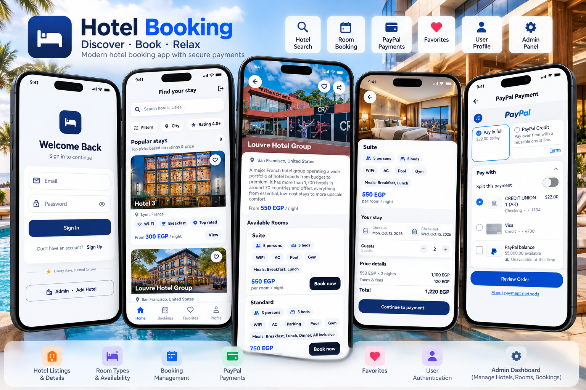

<div align="center">

# 🏨 Hotel Booking System

### Flutter • Supabase • PostgreSQL • PayPal

A modern, cross-platform hotel reservation
and management application built with
**Flutter, Dart, Supabase, and PayPal**.

The system provides a seamless hotel booking
experience for customers and a dedicated
management interface for administrators.


</div>

---

## 📸 Project Preview

<div align="center">

<a href="6bcc7afc-8fef-4ed4-92bf-5537273da748.png">
  
</a>

</div>

---

## 📖 About the Project

**Hotel Booking System** is a Flutter-based
application designed to simplify hotel
reservations and hotel administration.

The system consists of two main interfaces:

- **Customer Application:** Allows users to
  discover hotels, explore available rooms,
  manage favorites, and make reservations.

- **Admin Application:** Allows administrators
  to manage hotels, rooms, availability,
  and booking-related information.

The application integrates Supabase for
backend services and PayPal for payments.

---

## ✨ Key Features

### 👤 Authentication & User Management

- User registration and login.
- Secure authentication with Supabase.
- User profile management.
- User and administrator interfaces.

### 🏨 Hotel Discovery

- Browse available hotels.
- View hotel details and images.
- Search for hotels.
- Explore room types and facilities.
- View room information and pricing.

### 🛏️ Room Management

- Browse hotel rooms.
- View room details.
- Check room availability.
- Select rooms for reservations.

### 📅 Booking Management

- Create hotel reservations.
- Select booking dates.
- Manage reservation information.
- View booking details.
- Track booking records.

### ❤️ Favorites

- Save favorite hotels.
- Access saved hotels.
- Manage favorite selections.

### 💳 PayPal Integration

- PayPal payment integration.
- Payment processing workflow.
- Booking-related payments.

### 🛠️ Admin Management

- Manage hotel information.
- Add and update hotel listings.
- Manage rooms and room details.
- Manage availability.
- Review booking information.

### 📱 User Experience

- Modern Flutter interface.
- Responsive layouts.
- Intuitive navigation.
- Reusable UI components.

---

## 🛠️ Technologies Used

| Technology | Purpose |
|------------|---------|
| Flutter | Cross-platform UI |
| Dart | Application logic |
| Supabase | Backend services |
| PostgreSQL | Database |
| Supabase Auth | Authentication |
| PayPal | Payment integration |
| REST APIs | Backend communication |
| Git & GitHub | Version control |

---

## 🏗️ System Architecture

The application connects customer and
administrator interfaces to a shared
Supabase backend.

```text
       Hotel Booking System
                |
       +--------+--------+
       |                 |
       v                 v
  Customer App       Admin App
       |                 |
       +--------+--------+
                |
                v
         Supabase Backend
                |
      +---------+---------+
      |         |         |
      v         v         v
     Auth    Database   Storage
                |
                v
       Hotels / Rooms /
       Users / Bookings

       Payment Integration
                |
                v
              PayPal
```

---

## 🔄 Booking Workflow

```text
      User Registration
              |
              v
        Browse Hotels
              |
              v
         Select Hotel
              |
              v
        Explore Rooms
              |
              v
      Check Availability
              |
              v
        Select Dates
              |
              v
       Create Reservation
              |
              v
        PayPal Payment
              |
              v
       Booking Management
```

---

## 👥 User Roles

### Customer

Customers can:

- Browse hotels and rooms.
- Search for accommodation.
- Save favorite hotels.
- Make reservations.
- Complete payments.
- View booking information.

### Administrator

Administrators can:

- Manage hotel listings.
- Add and edit rooms.
- Update room availability.
- Manage hotel information.
- Review reservations.

---

## 🚀 Getting Started

### Prerequisites

Install the following:

- Flutter SDK
- Dart SDK
- Android Studio or VS Code
- Git
- Supabase project
- PayPal developer account for testing

### 1. Clone the Repository

```bash
git clone <YOUR_HOTEL_REPOSITORY_URL>
```

Replace the URL above with your actual
GitHub Hotel Booking repository URL.

### 2. Navigate to the Project

```bash
cd <YOUR_PROJECT_FOLDER>
```

### 3. Install Dependencies

```bash
flutter pub get
```

### 4. Configure Supabase

Create a Supabase project and configure
the application with:

- Supabase Project URL.
- Supabase publishable/anon key.
- Required PostgreSQL database tables.
- Authentication settings.
- Storage buckets, if used.
- Row Level Security policies.

Ensure the database schema matches
the application's existing models.

Never expose a Supabase service-role
key inside the Flutter application.

### 5. Configure PayPal

Configure the PayPal integration using
the existing project implementation.

Use PayPal Sandbox for testing.

Keep PayPal secret credentials on
a secure backend, not in Flutter.

### 6. Run the Application

```bash
flutter run
```

Note: The application requires the
corresponding Supabase schema and
payment configuration to work correctly.

---

## 💡 Development Highlights

This project demonstrates experience in:

- Developing booking applications.
- Building customer and admin interfaces.
- Integrating Flutter with Supabase.
- Managing relational database records.
- Implementing authentication.
- Handling hotel and room information.
- Developing reservation workflows.
- Integrating online payments.
- Building responsive Flutter interfaces.

---

## 🎯 Project Goals

- Simplify the hotel reservation process.
- Improve the accommodation search experience.
- Centralize hotel and room management.
- Provide an intuitive customer interface.
- Support efficient administration.
- Integrate digital payments.

---

## 👨‍💻 Developer

**Ahmed Jaber Ahmed**

Flutter Developer | Mobile App Developer

B.Sc. Computer Science & Artificial Intelligence

📍 Cairo, Egypt

- [GitHub](https://github.com/AhmedJaberAhmed)
- [Portfolio](https://ahmedjaberahmed.github.io/Jaber-website/)
- [LinkedIn](https://www.linkedin.com/in/ahmedjaberahmed/)

---

<div align="center">

### ⭐ Support the Project

If you find this project interesting,
consider giving it a star!

**Built with Flutter 💙**

</div>
